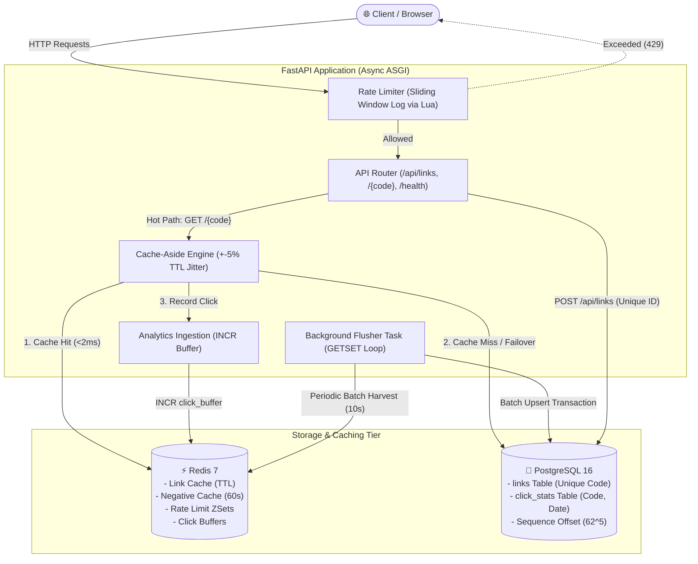

# LinkLite ⚡

[](https://github.com/ajaysinghrathore/LinkLite/actions/workflows/ci.yml)
[](https://www.python.org/downloads/)
[](https://fastapi.tiangolo.com)
[](https://www.postgresql.org/)
[](https://redis.io/)
[](tests/)
[](Dockerfile)
[](LICENSE)

**LinkLite** is a high-performance, production-grade URL shortening and analytics platform engineered in Python 3.11 and FastAPI. It delivers sub-millisecond redirect lookups via a Redis cache-aside architecture, guarantees strict concurrency correctness under high write contention using PostgreSQL unique constraints, protects upstream services with an atomic Redis Lua sliding-window rate limiter, and ingests click analytics asynchronously through a write-decoupled in-memory buffer. The project is designed with zero-downtime fault tolerance, degrading gracefully to PostgreSQL with a 0.0% error rate if Redis experiences an outage.

---

## Architecture Overview



---

## Key Features & Production Engineering Guarantees

- **Deterministic Base62 Codes with Zero Collisions**: Auto-generated codes are derived by Base62-encoding a PostgreSQL 64-bit sequence with an offset of $62^5 = 916{,}132{,}832$, guaranteeing that all generated short codes are at least 6 characters long from day one ($O(1)$ computation, zero collision-retry loops).
- **HTTP 302 vs. 301 Semantics**: Uses `302 Found` rather than `301 Moved Permanently` to prevent client browser disk caching, ensuring 100% analytics fidelity and instant link invalidation/expiry worldwide.
- **Cache-Aside with Negative Caching & Jitter**: Caches active links in Redis with $\pm 5\%$ randomized TTL jitter to prevent cache stampedes, and caches missing codes (`link_not_found:{code}`) for 60s to defend against cache penetration attacks.
- **Atomic Sliding Window Rate Limiting**: Employs an atomic Redis Lua script operating over Sorted Sets (`ZREMRANGEBYSCORE`, `ZCARD`, `ZADD`) to eliminate race conditions under burst traffic, providing accurate `X-RateLimit-*` and `Retry-After` headers.
- **Write-Decoupled Click Analytics**: Redirects never execute synchronous SQL writes. Clicks are buffered via Redis `INCR` and harvested periodically by a background task using atomic `GETSET key 0` with automatic `INCRBY` rollback on database transaction failure.
- **Fail-Open Resilience**: If Redis suffers a complete network partition or crash, redirects fall back to PostgreSQL and rate limiting fails open with structured warning logs (`REDIS_UNAVAILABLE`), preventing service blackouts.
- **Strict Concurrency Protection**: High-concurrency alias collisions are resolved strictly via PostgreSQL database-level `UNIQUE` constraints and `IntegrityError` handling, guaranteeing zero duplicates.
- **Minimal, XSS-Immune Analytics Dashboard**: A single-page dashboard served at `/` with zero build step, using pinned Chart.js (v4.4.4) and strict native `.textContent` DOM manipulation for absolute immunity against Cross-Site Scripting.

---

## Quickstart (Docker Compose)

The fastest way to launch LinkLite with its full production stack (FastAPI, PostgreSQL 16, Redis 7) is via Docker Compose:

```bash
# 1. Clone repository
git clone https://github.com/ajaysinghrathore/LinkLite.git
cd LinkLite

# 2. Copy environment template
cp .env.example .env

# 3. Build and launch containers
docker compose up -d

# 4. View container status
docker compose ps
```

The service will be available at:
- **Web Dashboard**: [http://localhost:8000/](http://localhost:8000/)
- **Swagger Interactive API Docs**: [http://localhost:8000/docs](http://localhost:8000/docs)
- **Health Check Endpoint**: [http://localhost:8000/health](http://localhost:8000/health)

---

## Local Development Setup

```bash
# 1. Create and activate virtual environment (Python 3.11+)
python3.11 -m venv .venv
source .venv/bin/activate

# 2. Install dependencies
pip install -r requirements.txt -r requirements-dev.txt

# 3. Start local PostgreSQL and Redis containers
docker compose up -d postgres redis

# 4. Apply Alembic database migrations
alembic upgrade head

# 5. Start development server with auto-reload
uvicorn app.main:app --host 0.0.0.0 --port 8000 --reload
```

---

## API Reference & Examples

### 1. Create a Short Link
`POST /api/links` (Rate limit: 10 req/min by default)

```bash
# Auto-generated 6-character short code
curl -X POST http://localhost:8000/api/links \
  -H "Content-Type: application/json" \
  -d '{"long_url": "https://fastapi.tiangolo.com/tutorial/"}'

# Custom alias with optional future expiration
curl -X POST http://localhost:8000/api/links \
  -H "Content-Type: application/json" \
  -d '{
    "long_url": "https://github.com/fastapi/fastapi",
    "custom_alias": "fastapi-repo",
    "expires_at": "2026-12-31T23:59:59Z"
  }'
```
**Response (201 Created)**:
```json
{
  "code": "fastapi-repo",
  "short_url": "http://localhost:8000/fastapi-repo",
  "long_url": "https://github.com/fastapi/fastapi",
  "created_at": "2026-10-18T13:00:00Z",
  "expires_at": "2026-12-31T23:59:59Z",
  "click_count": 0
}
```

### 2. Redirect to Target URL
`GET /{code}` (Rate limit: 300 req/min by default)

```bash
curl -i http://localhost:8000/fastapi-repo
```
**Response**: `HTTP/1.1 302 Found`, `Location: https://github.com/fastapi/fastapi`

### 3. Get Link Details & Total Clicks
`GET /api/links/{code}`

```bash
curl http://localhost:8000/api/links/fastapi-repo
```

### 4. Get 30-Day Click Analytics
`GET /api/links/{code}/stats`

```bash
curl http://localhost:8000/api/links/fastapi-repo/stats
```
**Response (200 OK)**:
```json
{
  "code": "fastapi-repo",
  "total_clicks": 142,
  "daily_clicks": [
    {"date": "2026-10-17", "clicks": 80},
    {"date": "2026-10-18", "clicks": 62}
  ]
}
```

### 5. Soft-Delete Link (Evicts Cache)
`DELETE /api/links/{code}`

```bash
curl -X DELETE -i http://localhost:8000/api/links/fastapi-repo
```
**Response**: `HTTP/1.1 204 No Content`

### 6. Health Check Probe
`GET /health`

```bash
curl http://localhost:8000/health
```
**Response (200 OK)**:
```json
{
  "status": "healthy",
  "database": "connected",
  "redis": "connected",
  "environment": "development"
}
```

---

## Configuration Reference

LinkLite is configured via environment variables using Pydantic Settings (`.env` file):

| Variable | Default Value | Description |
| :--- | :--- | :--- |
| `ENVIRONMENT` | `development` | Deployment environment (`development`, `production`, `testing`) |
| `DEBUG` | `false` | Enables SQLAlchemy SQL echo and verbose debug logging |
| `BASE_URL` | `http://localhost:8000` | Public root URL used to construct short link responses |
| `POSTGRES_USER` | `postgres` | PostgreSQL username |
| `POSTGRES_PASSWORD` | `postgres` | PostgreSQL password |
| `POSTGRES_HOST` | `localhost` | PostgreSQL host address |
| `POSTGRES_PORT` | `5432` | PostgreSQL port |
| `POSTGRES_DB` | `linklite` | Database name |
| `DATABASE_URL` | `None` | Optional complete asyncpg connection string override |
| `REDIS_URL` | `redis://localhost:6379/0` | Redis connection URL |
| `REDIS_CACHE_TTL_SECONDS` | `86400` (24h) | Base TTL for cached link entries |
| `REDIS_NEGATIVE_CACHE_TTL_SECONDS` | `60` (1m) | TTL for negative 404 cache keys |
| `ENABLE_CACHE` | `true` | Toggles Redis cache-aside (set `false` for raw DB baseline) |
| `RATE_LIMIT_CREATE_PER_MINUTE` | `10` | Allowed link creation requests per client IP per minute |
| `RATE_LIMIT_REDIRECT_PER_MINUTE` | `300` | Allowed redirect requests per client IP per minute |
| `TRUST_PROXY_HEADERS` | `false` | Set `true` only behind trusted reverse proxies (Cloudflare, ALB) |
| `ANALYTICS_FLUSH_INTERVAL_SECONDS`| `10` | Background worker interval to flush Redis click counts to DB |

---

## Automated Testing & Verification

The test suite covers unit, integration, and high-concurrency scenarios against real PostgreSQL and Redis containers:

```bash
# Run all tests
.venv/bin/pytest -v

# Run concurrency stress tests
.venv/bin/pytest tests/test_concurrency.py -v

# Run tests with coverage report (threshold >= 80%)
.venv/bin/pytest --cov=app --cov-report=term-missing
```

### Test Suite Summary
- **68 automated tests** passing in **5.3s**.
- **87% overall test coverage**:
  - `app/services/cache_service.py`: **99%**
  - `app/core/rate_limiter.py`: **98%**
  - `app/core/base62.py`: **97%**
  - `app/api/redirect.py`: **93%**
  - `app/api/health.py`: **93%**
  - `app/schemas/link.py`: **93%**
  - `app/services/link_service.py`: **87%**
  - `app/models/link.py`: **86%**

---

## Empirical Load Testing & Benchmarks

All benchmarks were executed via Locust 2.46.7 headless runner on an **Apple M4 (10 cores, 16 GB RAM)** against real Docker containers. Read the full benchmark documentation in [`docs/BENCHMARKS.md`](docs/BENCHMARKS.md).

```bash
# Execute automated benchmark suite
.venv/bin/python benchmarks/run_suite.py
```

### Summary Results Table

| Benchmark Scenario | Throughput (Req/s) | p50 Latency | p95 Latency | p99 Latency | Failure Rate |
| :--- | :--- | :--- | :--- | :--- | :--- |
| **Cache Enabled (`ENABLE_CACHE=true`)** | **482.94 req/s** | **61 ms** | **110 ms** | **150 ms** | **0.0%** (0 failures) |
| **Cache Disabled (`ENABLE_CACHE=false`)** | **235.34 req/s** | **150 ms** | **250 ms** | **320 ms** | **0.0%** (0 failures) |
| **Rate Limit Burst (Throttled)** | **301.57 req/s** | **73 ms** | **110 ms** | **150 ms** | **0.0%** (429 verified) |
| **Redis Stopped (Degraded Fallback)** | **9.02 req/s** | **2,600 ms** | **3,800 ms** | **3,900 ms** | **0.0%** (100% 302s) |

> **Key Takeaway**: Redis cache-aside delivers an empirical **2.05x throughput improvement** and a **59.3% reduction in median response latency** compared to raw PostgreSQL reads, while sustaining a **0.0% failure rate** when Redis experiences a complete outage.

---

## Architectural Decision Records (ADRs)

Every major technical and architectural decision is documented following the ADR format in [`docs/DECISIONS.md`](docs/DECISIONS.md):

- [ADR-001: Short Code Generation via Base62 Encoding with Sequence Offset](docs/DECISIONS.md#adr-001-short-code-generation-via-base62-encoding-of-sequential-db-id-with-offset)
- [ADR-002: HTTP 302 Found vs. HTTP 301 Moved Permanently](docs/DECISIONS.md#adr-002-http-302-found-vs-http-301-moved-permanently-for-redirects)
- [ADR-003: Redis Cache-Aside with Graceful Fallback (Fail-Open)](docs/DECISIONS.md#adr-003-redis-cache-aside-with-graceful-fallback-fail-open)
- [ADR-004: Soft Deletion (`is_deleted`) vs. Hard Deletion](docs/DECISIONS.md#adr-004-soft-deletion-is_deleted-vs-hard-deletion-delete-from)
- [ADR-007: Concurrency Control via Database Unique Constraint](docs/DECISIONS.md#adr-007-concurrency-control-via-database-unique-constraint)
- [ADR-011: Sliding Window Log Rate Limiter via Atomic Redis Lua Script](docs/DECISIONS.md#adr-011-sliding-window-log-rate-limiter-via-atomic-redis-lua-script)
- [ADR-013: Write-Decoupled Click Analytics Ingestion & Eventual Consistency](docs/DECISIONS.md#adr-013-write-decoupled-click-analytics-ingestion--eventual-consistency)
- [ADR-014: Zero-Trust Frontend DOM Manipulation & XSS Prevention](docs/DECISIONS.md#adr-014-zero-trust-frontend-dom-manipulation--xss-prevention)
- [ADR-015: Automated Concurrency Testing & Real-Service Isolation Strategy](docs/DECISIONS.md#adr-015-automated-concurrency-testing--real-service-isolation-strategy)
- [ADR-016: Multi-Stage Production Containerization with Non-Root Security](docs/DECISIONS.md#adr-016-multi-stage-production-containerization-with-non-root-security-and-built-in-health-checks)
- [ADR-018: Runtime Cache Bypass (`ENABLE_CACHE`) & Empirical Load Testing](docs/DECISIONS.md#adr-018-runtime-cache-bypass-enable_cache-and-automated-empirical-load-testing)

---

## Limitations & Future Work

1. **Distributed ID Sharding (Twitter Snowflake)**: For a multi-region, multi-primary database topology, replacing the single PostgreSQL sequence with a distributed 64-bit ID generator (e.g. Snowflake) eliminates the single-primary database bottleneck.
2. **Counting Bloom Filters for Cache Penetration**: While negative caching protects recently queried non-existent keys for 60s, a Redis-backed Scalable Bloom Filter or Cuckoo Filter could reject unknown short codes in $O(1)$ time with zero database queries.
3. **Kafka / Redpanda Event Streaming**: At billions of daily redirects, replacing the periodic Redis buffer flush with an asynchronous Apache Kafka event topic enables real-time geographic, user-agent, and referrer analytics processing via Apache Flink or ClickHouse.
4. **Anycast Edge Redirection**: Terminating TLS and serving Redis reads at the CDN edge (Cloudflare Workers / AWS CloudFront Functions) to reduce global redirection latencies to <10ms worldwide.

---

## License

LinkLite is open-source software licensed under the [MIT License](LICENSE).
