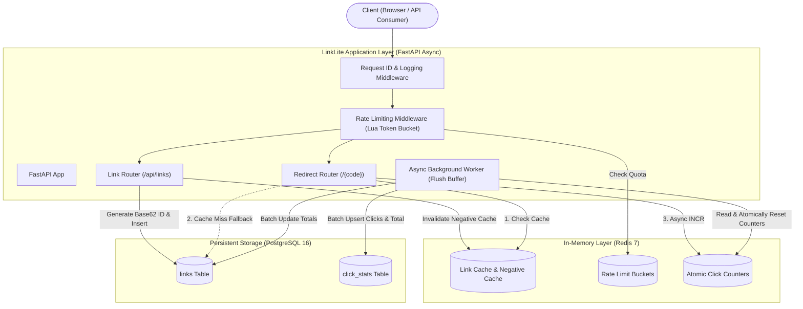
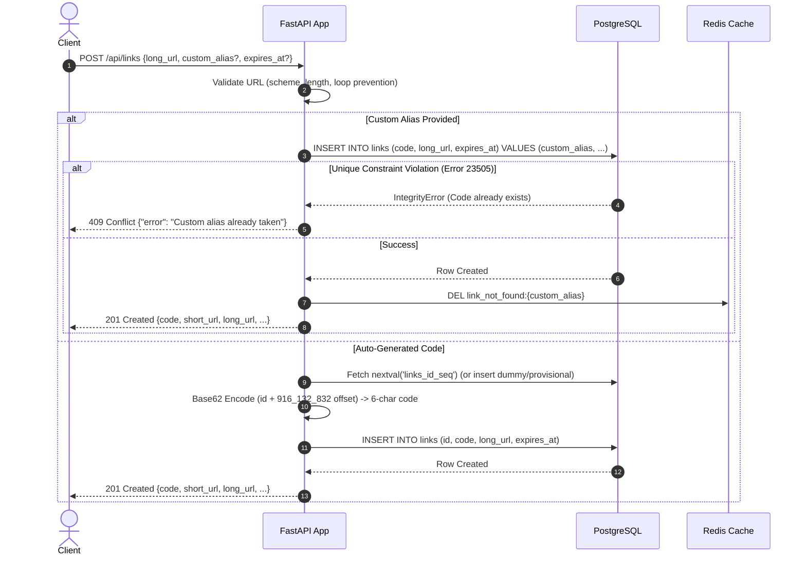
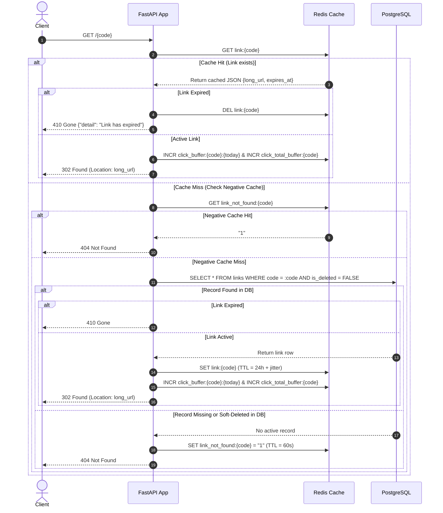

# LinkLite System Design Document (Phase 0)

LinkLite is a high-throughput, low-latency URL shortener service built with Python 3.11+, FastAPI, PostgreSQL, and Redis. It is designed to demonstrate production-grade software engineering patterns: robust concurrency control, caching with degradation fallbacks, atomic rate limiting, and write-decoupled analytics ingestion.

---

## 1. Requirements Summary

### 1.1 Functional Requirements
1. **Link Creation (`POST /api/links`)**:
   - Shorten long URLs (HTTP/HTTPS only, max length 2048 chars).
   - Reject malformed URLs, `javascript:`/`data:` schemes, and self-referential domain redirects (loop prevention).
   - Optional parameters: `custom_alias` (3–32 alphanumeric chars plus `_` and `-`, excluding reserved keywords) and `expires_at` (future ISO-8601 timestamp).
   - Return short URL, short code, original URL, creation timestamp, and expiration timestamp.
2. **Redirection (`GET /{code}`)**:
   - HTTP 302 Found redirect to preserve click observability.
   - Return HTTP 404 for unknown or soft-deleted codes.
   - Return HTTP 410 Gone for expired links.
3. **Link Details (`GET /api/links/{code}`)**:
   - Return metadata and total click counts.
4. **Analytics (`GET /api/links/{code}/stats`)**:
   - Return total clicks and daily click breakdown for the past 30 days.
5. **Deletion (`DELETE /api/links/{code}`)**:
   - Soft-delete link record (`is_deleted = TRUE`) and immediately evict/invalidate cache entries.
6. **Health Check (`GET /health`)**:
   - Probe PostgreSQL connection and Redis ping, returning service status.

### 1.2 Non-Functional Requirements
- **Low-Latency Reads**: P99 redirect latency $< 10\text{ms}$ on cache hits using Redis in-memory lookup.
- **High Concurrency & Idempotency**: Strict uniqueness enforcement using database-level `UNIQUE` constraints and transactional concurrency control—never vulnerable to check-then-insert race conditions.
- **Graceful Degradation (Fail-Open)**: If Redis is unavailable, the service continues serving redirects directly from PostgreSQL, logs a structured warning, and allows traffic through rate limiters (fails open) rather than terminating user requests.
- **Decoupled Write Path for Analytics**: Click counting must not execute synchronous relational database writes on the hot redirect path.
- **Observability**: Structured JSON logging with propagated `request_id` context.

---

## 2. Back-of-the-Envelope Capacity Estimation

We dimension the system for a production-scale deployment with a 3-year operational window.

### 2.1 Traffic & QPS Assumptions
- **Total active links**: $100{,}000{,}000$ ($100\text{M}$) links over 3 years.
- **Read-to-Write ratio**: $100:1$ (typical read-heavy consumer workload).
- **Writes per second**:
  $$\text{Total writes} = 100{,}000{,}000 \text{ writes}$$
  $$\text{Seconds in 3 years} = 3 \times 365 \times 86{,}400 \approx 9.46 \times 10^7\text{ seconds}$$
  $$\text{Average Write QPS} = \frac{100{,}000{,}000}{94{,}600{,}000} \approx 1.06\text{ writes/sec}$$
  $$\text{Peak Write QPS (5x multiplier)} \approx 5.3\text{ writes/sec}$$
- **Reads (Redirects) per second**:
  $$\text{Average Read QPS} = 1.06 \times 100 \approx 106\text{ reads/sec}$$
  $$\text{Peak Read QPS (10x burst/marketing spike)} \approx 1{,}060\text{ reads/sec}$$

### 2.2 Storage Capacity (PostgreSQL)
Each record in the `links` table contains:
- `id`: BIGINT (8 bytes)
- `code`: VARCHAR(32) (average 8 bytes)
- `long_url`: VARCHAR(2048) (average 100 bytes)
- `created_at`: TIMESTAMPTZ (8 bytes)
- `expires_at`: TIMESTAMPTZ (8 bytes)
- `is_deleted`: BOOLEAN (1 byte)
- `click_count`: BIGINT (8 bytes)
- Row header & tuple overhead: ~32 bytes
- B-Tree indexes on `id`, `code`, and `expires_at`: ~150 bytes per row

$$\text{Estimated storage per link record} \approx 320\text{ bytes (rounded to } 500\text{ bytes for safety)}$$
$$\text{Storage for } 100\text{M links} = 100\text{M} \times 500\text{ bytes} \approx 50\text{ GB over 3 years}$$

For `click_stats` (daily rollup table):
- `(code, date, count)`: ~60 bytes per row with index.
- If an active link is clicked on an average of 10 distinct days per month, storing 30 days of history for $1\text{M}$ active monthly links requires:
  $$1\text{M} \times 10 \times 60\text{ bytes} \approx 600\text{ MB}$$

*Conclusion*: PostgreSQL storage requirements ($\sim 50\text{ GB}$) fit comfortably on a single standard managed database instance without requiring immediate horizontal database sharding.

### 2.3 Cache Capacity (Redis)
We apply the **80/20 Pareto Principle**: $20\%$ of hot URLs generate $80\%$ of read traffic.
- Active URLs accessed in a typical 24-hour cycle: $\sim 10\text{M daily redirects} \div 10\text{ clicks/link} = 1{,}000{,}000$ unique links.
- Top $20\%$ hot working set = $200{,}000$ links.
- Redis key + value memory footprint per link:
  - Key: `link:{code}` (~16 bytes)
  - Value: JSON payload `{"long_url":"...","expires_at":null}` (~180 bytes)
  - Redis memory allocator overhead: ~150 bytes per key
  - Total per cached item $\approx 350\text{ bytes}$.
- Required RAM for hot working set:
  $$200{,}000 \times 350\text{ bytes} \approx 70\text{ MB}$$
- Even caching $5\text{M}$ links simultaneously requires only:
  $$5{,}000{,}000 \times 350\text{ bytes} \approx 1.75\text{ GB RAM}$$

*Conclusion*: A 2 GB to 4 GB Redis instance is more than sufficient for the working set, rate-limit buckets, and write-buffer counters.

### 2.4 Network Bandwidth
- **Ingress (Writes)**: $1.06\text{ writes/sec} \times 1\text{ KB} \approx 1.1\text{ KB/sec}$ (negligible).
- **Egress (Redirects)**: $106\text{ reads/sec} \times 400\text{ bytes (HTTP 302 Header)} \approx 42.4\text{ KB/sec}$.
- **Peak Egress**: $1{,}060\text{ reads/sec} \times 400\text{ bytes} \approx 424\text{ KB/sec}$.

---

## 3. API Contract

### 3.1 Conventions
- All API payloads are `application/json`.
- Timestamps are formatted as ISO-8601 UTC strings (e.g., `2026-10-12T12:00:00Z`).
- Custom headers:
  - `X-Request-ID`: Distributed tracing UUID echoed in every response.
  - `X-RateLimit-Limit`, `X-RateLimit-Remaining`, `X-RateLimit-Reset`: Rate limit telemetry.

---

### 3.2 Endpoints

#### 1. Create Short Link
- **Endpoint**: `POST /api/links`
- **Request Body**:
  ```json
  {
    "long_url": "https://example.com/very/long/path?param=value",
    "custom_alias": "launch2026",
    "expires_at": "2026-12-31T23:59:59Z"
  }
  ```
  *(Note: `custom_alias` and `expires_at` are optional).*
- **Validation Rules**:
  - `long_url`: Must be valid HTTP or HTTPS URI, length $\le 2048$, no loopback to LinkLite's host.
  - `custom_alias`: Regex `^[A-Za-z0-9_-]{3,32}$`. Disallow reserved words: `api`, `docs`, `health`, `admin`, `static`, `redoc`, `openapi.json`.
  - `expires_at`: Must be a future timestamp.
- **Responses**:
  - `201 Created`:
    ```json
    {
      "code": "launch2026",
      "short_url": "http://localhost:8000/launch2026",
      "long_url": "https://example.com/very/long/path?param=value",
      "created_at": "2026-10-12T12:00:00Z",
      "expires_at": "2026-12-31T23:59:59Z"
    }
    ```
  - `400 Bad Request`: Validation failure (malformed URL, invalid scheme, self-reference).
  - `409 Conflict`: `{"error": "Custom alias 'launch2026' is already in use."}`
  - `422 Unprocessable Entity`: Schema failure.
  - `429 Too Many Requests`: Rate limit breached.

#### 2. Redirect to Target
- **Endpoint**: `GET /{code}`
- **Responses**:
  - `302 Found`:
    - Headers: `Location: https://example.com/very/long/path?param=value`
  - `404 Not Found`: Unknown code or soft-deleted code (`{"detail": "Link not found"}`).
  - `410 Gone`: Expired link (`{"detail": "Link has expired"}`).
  - `429 Too Many Requests`: Redirect rate limit exceeded.

#### 3. Get Link Details
- **Endpoint**: `GET /api/links/{code}`
- **Responses**:
  - `200 OK`:
    ```json
    {
      "code": "launch2026",
      "short_url": "http://localhost:8000/launch2026",
      "long_url": "https://example.com/very/long/path?param=value",
      "created_at": "2026-10-12T12:00:00Z",
      "expires_at": "2026-12-31T23:59:59Z",
      "click_count": 42
    }
    ```
  - `404 Not Found`: Link does not exist or has been deleted.

#### 4. Get Link Analytics
- **Endpoint**: `GET /api/links/{code}/stats`
- **Responses**:
  - `200 OK`:
    ```json
    {
      "code": "launch2026",
      "total_clicks": 42,
      "daily_clicks": [
        {"date": "2026-10-11", "clicks": 18},
        {"date": "2026-10-12", "clicks": 24}
      ]
    }
    ```
  - `404 Not Found`: Link does not exist or has been deleted.

#### 5. Soft Delete Link
- **Endpoint**: `DELETE /api/links/{code}`
- **Responses**:
  - `204 No Content`: Successfully marked as deleted and cache evicted.
  - `404 Not Found`: Link does not exist or was already deleted.

#### 6. Health Check
- **Endpoint**: `GET /health`
- **Responses**:
  - `200 OK`:
    ```json
    {
      "status": "healthy",
      "postgres": "connected",
      "redis": "connected"
    }
    ```
  - `503 Service Unavailable`:
    ```json
    {
      "status": "degraded",
      "postgres": "connected",
      "redis": "disconnected"
    }
    ```

---

## 4. Database Schema (PostgreSQL)

```sql
-- Links master table
CREATE TABLE links (
    id BIGINT GENERATED ALWAYS AS IDENTITY PRIMARY KEY,
    code VARCHAR(32) NOT NULL,
    long_url VARCHAR(2048) NOT NULL,
    created_at TIMESTAMPTZ NOT NULL DEFAULT (NOW() AT TIME ZONE 'UTC'),
    expires_at TIMESTAMPTZ NULL,
    is_deleted BOOLEAN NOT NULL DEFAULT FALSE,
    click_count BIGINT NOT NULL DEFAULT 0,
    CONSTRAINT uq_links_code UNIQUE (code)
);

-- Partial index for fast redirect & active query filtering
CREATE INDEX idx_links_code_active ON links (code) WHERE is_deleted = FALSE;

-- Index to accelerate background pruning of expired links
CREATE INDEX idx_links_expires_at ON links (expires_at) WHERE expires_at IS NOT NULL;

-- Click statistics daily rollup table
CREATE TABLE click_stats (
    id BIGINT GENERATED ALWAYS AS IDENTITY PRIMARY KEY,
    code VARCHAR(32) NOT NULL,
    date DATE NOT NULL,
    count BIGINT NOT NULL DEFAULT 0,
    CONSTRAINT uq_click_stats_code_date UNIQUE (code, date),
    CONSTRAINT fk_click_stats_code FOREIGN KEY (code) REFERENCES links(code) ON DELETE CASCADE
);

-- Index for fast 30-day range query
CREATE INDEX idx_click_stats_code_date ON click_stats (code, date DESC);
```

### Design Rationale:
1. **`id BIGINT GENERATED ALWAYS AS IDENTITY`**: 64-bit sequence provides up to $9.22 \times 10^{18}$ values, avoiding integer overflow.
2. **`code VARCHAR(32) UNIQUE`**: Guarantees physical unicity at the storage engine level. Concurrent identical inserts will trigger a PostgreSQL `23505 unique_violation`, caught cleanly in Python as SQLAlchemy `IntegrityError` to return HTTP 409.
3. **`is_deleted BOOLEAN` (Soft Delete)**: Preserves foreign-key referential integrity with `click_stats` and maintains historical telemetry without broken links in audit records.
4. **`click_count BIGINT` on `links`**: Denormalized aggregate count for $O(1)$ fast retrieval by `GET /api/links/{code}` without expensive `SUM()` table scans.

---

## 5. Redis Key Design & Caching Architecture

| Key Pattern | Redis Type | Purpose | TTL | Eviction / Invalidation Policy |
| :--- | :--- | :--- | :--- | :--- |
| `link:{code}` | String (JSON) | Caches long URL & expiry metadata | $86{,}400\text{s}$ (24h) + jitter (up to 300s); capped at `expires_at` | Evicted on `DELETE`, updated on change |
| `link_not_found:{code}` | String (`"1"`) | Negative caching for 404s (prevents cache penetration) | $60\text{s}$ (1 minute) | Evicted if code is created |
| `rate_limit:{route}:{client_ip}` | Hash / Sorted Set | Sliding window rate limiting counter | Sliding window size (e.g. 60s) | Auto-expires |
| `click_buffer:{code}:{YYYY-MM-DD}` | String (Counter) | Atomic `INCR` for daily click bucket | $172{,}800\text{s}$ (48h) | Flushed to PostgreSQL by background worker |
| `click_total_buffer:{code}` | String (Counter) | Atomic `INCR` for total click rollup | $172{,}800\text{s}$ (48h) | Flushed to PostgreSQL by background worker |

### 5.1 Caching Strategy
- **Pattern**: Cache-Aside (Lazy Loading).
- **Read Path**:
  1. Check `link:{code}`. If hit, parse metadata:
     - If `expires_at` is in the past: evict key, return HTTP 410.
     - Else: trigger async click count buffer increment, return HTTP 302.
  2. Check `link_not_found:{code}`. If hit, return HTTP 404 immediately.
  3. On cache miss: query PostgreSQL.
     - If row found and active: populate `link:{code}` with TTL $\min(24\text{h} + \text{jitter}, \text{remaining\_lifetime})$, return HTTP 302.
     - If row expired: return HTTP 410.
     - If row missing or `is_deleted`: set `link_not_found:{code}` with 60s TTL, return HTTP 404.
- **Cache Stampede Mitigation**:
  - Add random jitter ($\pm 5\%$) to standard TTL to prevent synchronized key expiry.
  - Fail-Open: If Redis connection drops, bypass cache and directly query PostgreSQL with structured warning logging.

---

## 6. Architecture & Sequence Diagrams

### 6.1 System Architecture Topology



---

### 6.2 Sequence Diagram: Create Short Link (`POST /api/links`)



---

### 6.3 Sequence Diagram: Redirect Flow (`GET /{code}`)



---

## 7. Short Code Generation Strategy

### 7.1 Base62 Encoding Mechanism
Base62 uses the character set:
`0123456789abcdefghijklmnopqrstuvwxyzABCDEFGHIJKLMNOPQRSTUVWXYZ` ($10 + 26 + 26 = 62\text{ characters}$).

- **Character Space Capacity**:
  - 6 characters: $62^6 = 56{,}800{,}235{,}584 \approx 56.8\text{ billion}$ unique combinations.
  - 7 characters: $62^7 = 3{,}521{,}614{,}606{,}208 \approx 3.52\text{ trillion}$ unique combinations.
- **Offset Guarantee**:
  - The smallest 6-character Base62 number corresponds to $62^5 = 916{,}132{,}832$.
  - By adding an offset of $916{,}132{,}832$ to our database sequence ID (`id + 916_132_832`), every generated code is guaranteed to be **at least 6 characters long** immediately upon startup.
- **Comparison to Alternatives**:
  - *Random string with collision retries*: Degrades exponentially as the table fills; requires multiple round-trip DB queries under load.
  - *MD5/SHA256 hash truncation*: Requires picking bytes (e.g. 43 bits) and suffers from the Birthday Paradox, requiring collision retry logic.
  - *Snowflake IDs*: Excellent for distributed multi-datacenter setups without central coordination, but produces 64-bit numbers resulting in 11-character Base62 codes. For a single-primary PostgreSQL system, a sequence is simpler, smaller, and guarantees $O(1)$ zero collisions.
